<h3><code>ricardo@github ~ $ neofetch</code></h3>

 

<a href="mailto:rdpcarvalho644@gmail.com">rdpcarvalho644@gmail.com</a>

 

<h3><code>ricardo@github ~ $ ls ~/proyectos</code></h3>

<table>
  <tr>
    <td align="center">
      
    </td>
    <td align="center">
      
    </td>
  </tr>
  <tr>
    <td align="center" colspan="2">
      
    </td>
  </tr>
</table>

<a href="https://portu142.github.io/LocalizadorCafeterias/">Ver demo en vivo de LocalizadorCafeterias</a>

 

<h3><code>ricardo@github ~ $ ./contribuciones.sh</code></h3>

